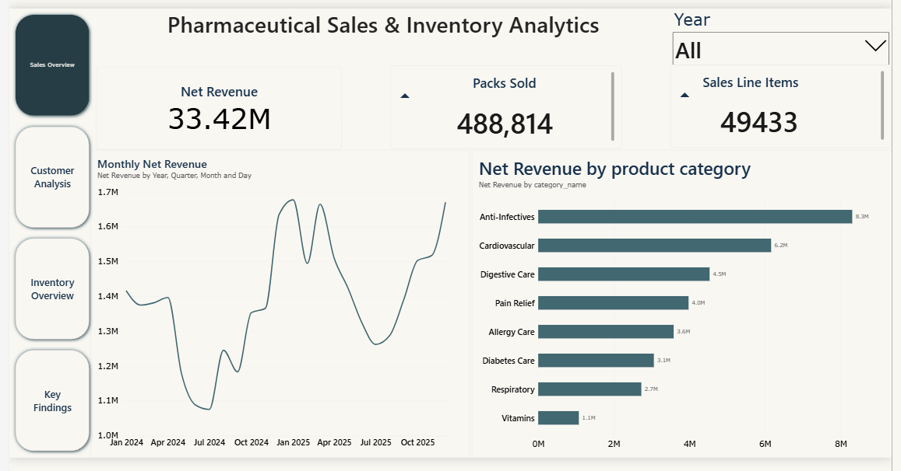
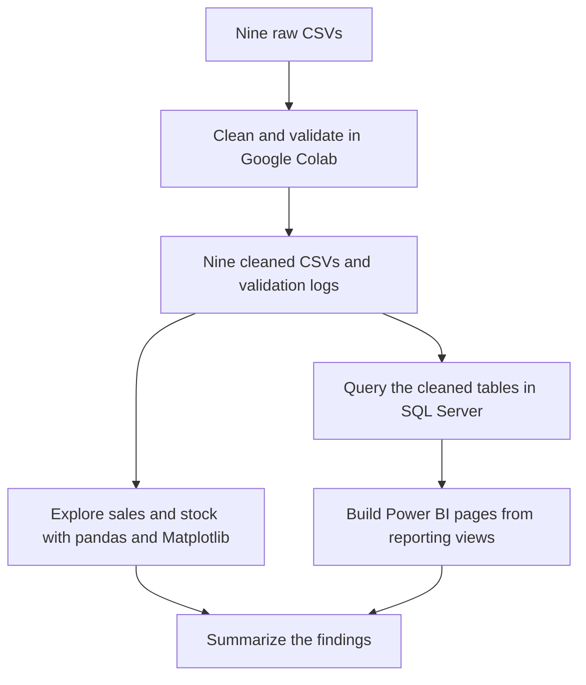
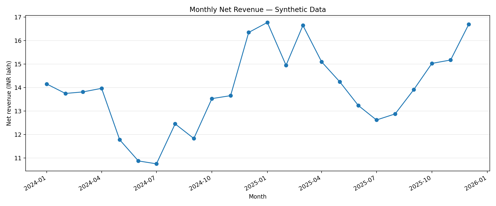

# Pharmaceutical Sales & Inventory Analytics

I built this project to answer three questions for a simulated pharmaceutical distributor. **How did sales change? Which customer groups drove revenue? Which products needed reorder or expiry review?**

I used Python and pandas in Google Colab to prepare nine synthetic datasets, Matplotlib to explore the results, SQL Server to build reporting views, and Power BI to present the findings. Sales cover **January 2024 through December 2025**. Inventory is reported **as of 31 December 2025**.

## How I built it

### 1. Understand the data and define the metrics

I mapped the keys between products, batches, customers, and sales using the nine raw CSVs. I defined net revenue as pack quantity times unit price, minus the discount rounded per sales line. I used the latest month-end snapshot for reorder checks and batch-level movements for expiry and stock value.

[Dataset ZIP with the nine input CSVs](data/Pharma_2024_2025_Improved_Data_v2.zip) · [Data dictionary](DATA_DICTIONARY.md)

### 2. Clean and validate the data with pandas

I profiled the files in Google Colab, removed **235 exact duplicate sales rows**, and kept **49,433** sales lines. I standardized dates, product IDs, and price formats. I mapped **161 missing customer IDs** to an explicit Unknown record so their revenue stayed in the totals.

I checked that each sale matched the right batch and fell within that batch’s valid dates. I rebuilt stock from receipts, sales, and signed adjustments, then checked it against **2,400 month-end stock records**. All 2,400 matched. The notebook exports the cleaned CSVs and both logs as a checkpoint.

[Google Colab notebook](notebooks/01_Start_Here_v2.ipynb) · [Cleaning log](eda/checks/cleaning_log.csv) · [Validation results](eda/checks/validation_results.csv)

### 3. Explore the results with pandas and Matplotlib

I reopened the cleaning checkpoint and aggregated the data by year, month, category, and product. I used **Matplotlib** to plot monthly net revenue, compare category revenue, and rank the ten highest-revenue products. The monthly chart showed the revenue peak in **January 2025**, at **₹1.68M**. This stage exported **12 summary tables and 3 charts**.

[Revenue by category](eda/charts/category_revenue.png) · [Top 10 products by revenue](eda/charts/top_10_products.png)

### 4. Turn the analysis into SQL reporting views

I imported the cleaned CSVs into SQL Server and wrote queries for sales trends, customer segments, reorders, stock coverage, and expiry. I combined receipts, sales, and stock adjustments into a movement view and used it to calculate the remaining quantity for each batch at year-end.

| Reporting view | What it feeds |
| --- | --- |
| `vw_SalesAnalysis` | Sales lines, quantities, and net revenue used on the Sales Overview and Customer Analysis pages |
| `vw_InventoryAnalysis_20251231` | Remaining packs, days to expiry, and value at batch cost used on the Inventory Overview page |

[SQL queries and view definitions](sql/analysis-and-reporting.sql)

### 5. Build the Power BI dashboard and summarize the findings

I built a year-filtered sales overview, a customer breakdown by type and location, and an inventory overview fixed to the 31 December snapshot. I used the Key Findings page to bring the business takeaways together.

[Sales overview](powerbi/sales-overview.png) · [Customer analysis](powerbi/customer-analysis.png) · [Inventory overview](powerbi/inventory-overview.png) · [Key findings](powerbi/key-findings.png)

## What the analysis found

| Business question | Finding |
| --- | --- |
| How did sales change? | Net revenue rose **12.95%**, from **₹15.69M in 2024** to **₹17.72M in 2025**. Across both years, **488,814 packs** were sold. |
| Which customer group drove revenue? | Pharmacies accounted for **49.99%** of net revenue. |
| What needed stock review? | The year-end snapshot held **23,396 packs**. **Four products** were at or below their reorder points. |
| What was approaching expiry? | **2,149 packs across 14 batches** were due to expire within 90 days of the snapshot. They represented **17.08%** of closing stock value at batch cost. |

## Run the notebook and SQL

1. Open the notebook in **Google Colab** and upload the dataset ZIP at the first prompt. Run the cleaning and validation cells and download `Pharma_Cleaning_Checkpoint.zip`.
2. Upload that checkpoint at the exploratory analysis prompt. Run the remaining cells to generate `Pharma_EDA_Checkpoint.zip` with the tables and Matplotlib charts.
3. In SQL Server, create a database named `PharmaAnalytics`. Import the nine cleaned CSVs from the checkpoint into `dbo`, using the file stems as table names. Use the data dictionary for column types and exact decimals for currency and discounts. Run the SQL script in SQL Server Management Studio after the tables are loaded.
4. Open the linked Power BI screenshots to see how the results were presented.

The dashboard’s India map uses boundary data from [geoBoundaries](https://www.geoboundaries.org/).
